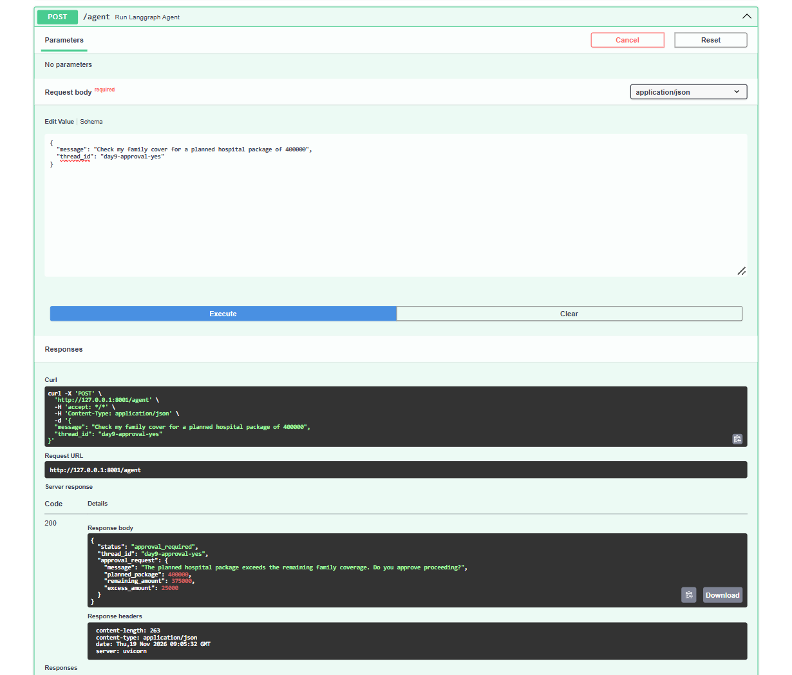
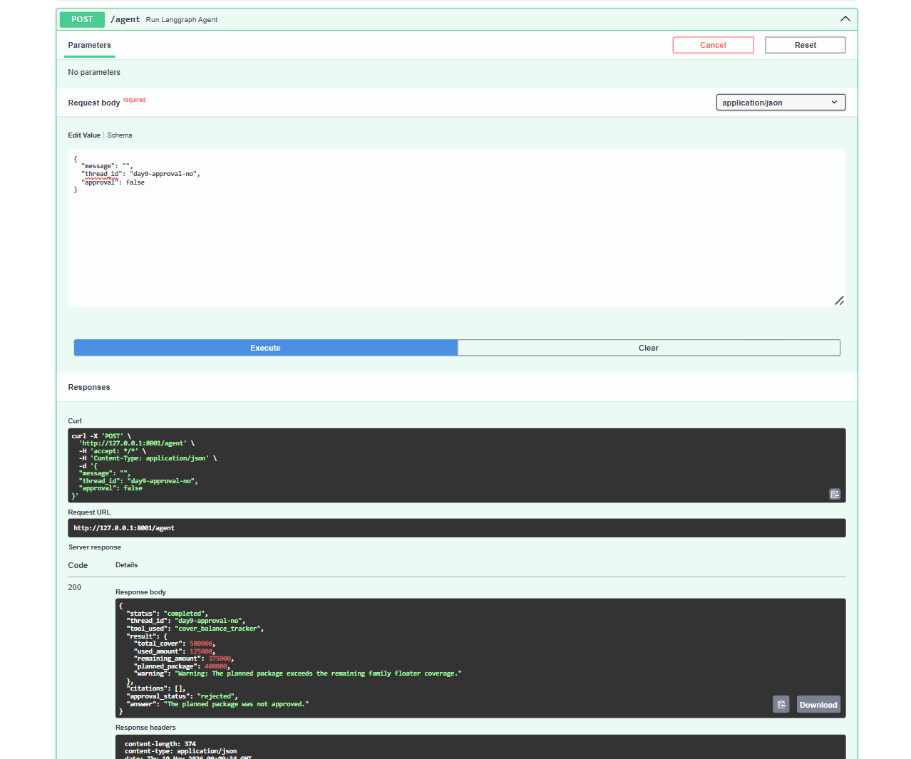

# 🏥 AyushmanSathi – AI-Powered Healthcare Assistant

## Project Overview

AyushmanSathi is a Generative AI-based healthcare assistant designed to make reliable healthcare information more accessible and understandable. It uses Retrieval-Augmented Generation (RAG) to retrieve information from trusted healthcare documents and generate context-based responses.

## Project Information

| Component | Description |
|---|---|
| Product Name | AyushmanSathi |
| Domain | Healthcare and Generative AI |
| Target Users | Patients, caregivers, and the general public |
| Data Sources | WHO, MoHFW, and other trusted public healthcare resources |
| Problem Statement | Difficulty accessing and understanding reliable healthcare information |
| Proposed Solution | Conversational AI healthcare assistant |

## Key Features

- Healthcare document extraction and processing.
- Text chunking and embedding generation.
- ChromaDB vector storage and semantic search.
- RAG-based question answering with citations.
- Gemini API integration.
- Keyword search and TF-IDF-based smart search.
- LangGraph-based AI agent.
- Conversation memory using InMemorySaver.
- Cover balance tracking.
- Human-in-the-loop approval workflow.
- FastAPI backend with REST APIs.
- Streamlit-based interactive chat interface.
- User feedback through thumbs up/down.

## Technology Stack

| Category | Technologies |
|---|---|
| Programming Language | Python |
| Backend | FastAPI |
| Frontend | Streamlit |
| Generative AI | Google Gemini API |
| Agent Framework | LangGraph |
| RAG | Custom RAG Pipeline |
| Vector Database | ChromaDB |
| Embeddings | Sentence Transformers |
| Document Processing | PyPDF |
| Machine Learning | TF-IDF, Cosine Similarity |
| API Testing | Swagger UI |
| Version Control | Git and GitHub |

## RAG Pipeline

1. Load healthcare documents.
2. Extract and clean text.
3. Split text into smaller chunks.
4. Generate text embeddings.
5. Store embeddings in ChromaDB.
6. Retrieve relevant information using semantic search.
7. Generate context-based answers with citations.

## LangGraph Agent

The AI agent uses different tools based on user requests:

- **RAG Search:** Retrieves relevant healthcare information.
- **Cover Balance Tracker:** Calculates used and remaining family coverage.
- **Conversation Memory:** Retains conversation state using thread IDs.
- **Human Approval:** Requests approval when a planned package exceeds the remaining coverage.

The approval workflow supports both approved and rejected outcomes.

## Evaluation Results

Two retrieval configurations were evaluated using 15 healthcare-related questions.

| Metric | Configuration A | Configuration B |
|---|---:|---:|
| Chunk Size | 500 | 1000 |
| Chunk Overlap | 150 | 150 |
| Top-K | 3 | 5 |
| Average Keyword Score | 0.3929 | 0.5444 |
| Citation Availability | 100% | 100% |

Configuration B was selected based on its higher average keyword score.

## API Endpoints

| Method | Endpoint | Description |
|---|---|---|
| GET | `/health` | Check API status |
| GET | `/records` | Retrieve healthcare records |
| GET | `/search` | Keyword-based search |
| GET | `/search/semantic` | Semantic search |
| POST | `/questions` | Search healthcare questions |
| POST | `/chat` | Gemini-based chat |
| POST | `/ask` | RAG-based question answering |
| POST | `/agent` | LangGraph agent execution |

## How to Run

### 1. Clone the repository

```bash
git clone https://github.com/ApurvaAdhav/ayushmansathi-GenAI.git
cd ayushmansathi-GenAI
```

### 2. Create a virtual environment

```bash
python -m venv .venv
```

Activate it:

```powershell
.venv\Scripts\Activate.ps1
```

### 3. Install dependencies

```bash
pip install -r requirements.txt
```

### 4. Configure environment variables

Create a `.env` file and add:

```env
GEMINI_API_KEY=your_api_key
```

Do not upload your `.env` file to GitHub.

### 5. Run the backend

```bash
python -m uvicorn app.main:app --reload --port 8001
```

### 6. Run the Streamlit application

Open another terminal and run:

```bash
streamlit run ui/app.py
```

### 7. Open the application

- API Documentation: http://127.0.0.1:8001/docs
- Streamlit UI: http://localhost:8501

## Human Approval Workflow

### Approval Granted


### Approval Rejected


## Future Scope

- Expand the healthcare knowledge base.
- Improve retrieval accuracy and response evaluation.
- Enhance citation verification.
- Add multilingual healthcare support.
- Improve conversational capabilities.

## Project Development

Developed as part of the GenAI Training Program at Sanjivani.

## Repository

[AyushmanSathi – GitHub Repository](https://github.com/ApurvaAdhav/ayushmansathi-GenAI)
